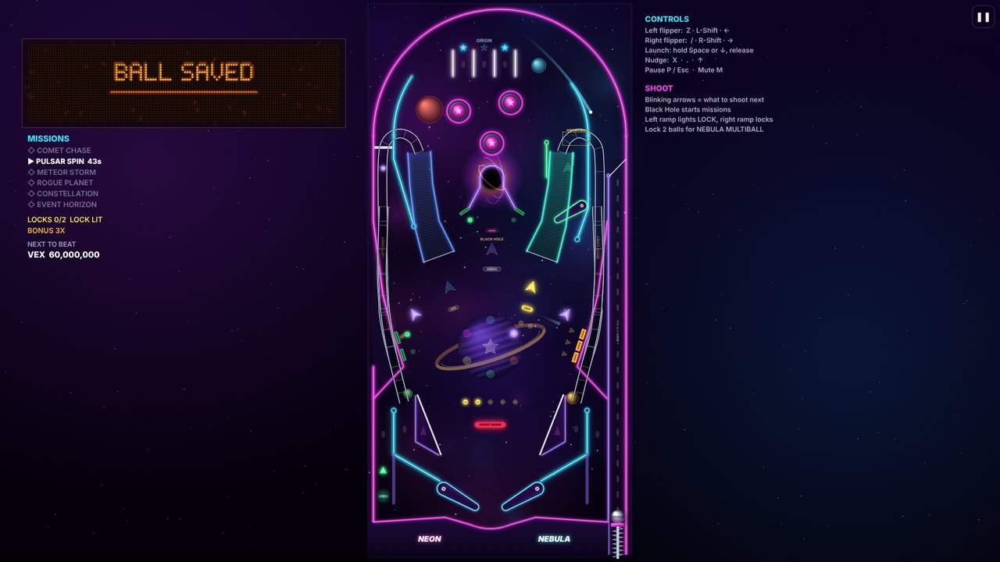
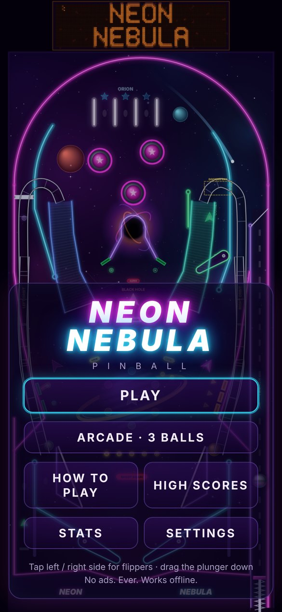
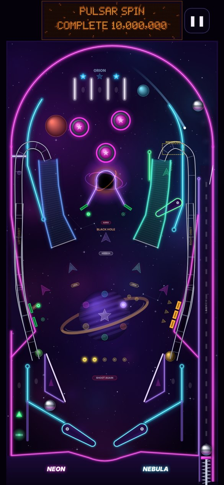

# NEON NEBULA — neon space pinball

Free. Works offline. **No ads, ever.**



<p>


</p>

## Play on your phone

Open **https://nisargpatel122.github.io/neon-nebula/** and tap **PLAY**.

To put it on your home screen like a normal app (it then works with no internet):

- **iPhone / iPad (Safari):** tap the **Share** button (square with an arrow), then **Add to Home Screen**, then **Add**.
- **Android (Chrome):** tap the **⋮** menu, then **Install app** (or **Add to Home screen**), then **Install**.

## Play on your computer

- **Easiest:** open the same link in Chrome or Edge. Chrome and Edge also show an
  **Install** icon at the right end of the address bar if you want it as an app.
- **Without internet:** download `index.html` (on GitHub, click `index.html`, then the
  **Download raw file** button ⤓), then double-click it. It opens in your browser and
  needs nothing else: no internet, no installing. If it opens in the wrong browser,
  right-click it → **Open with** → Chrome or Edge.

## Controls

| | Keyboard | Phone / tablet | Gamepad |
|---|---|---|---|
| Left flipper | `Z`, `Left Shift` or `←` | tap the left half of the screen | left shoulder or trigger |
| Right flipper | `/`, `Right Shift` or `→` | tap the right half | right shoulder or trigger |
| Launch ball | hold `Space` or `↓`, let go | drag the plunger (bottom right) down, let go | hold A, let go |
| Nudge the table | `X` left, `.` right, `↑` up | quick swipe up | X / B / Y |
| Pause | `P` or `Esc` | ❚❚ button | Start |
| Sound on/off | `M` | Settings | |

Nudge too much and you get a DANGER warning, then TILT (you lose the ball).

## The rules in a few lines

- You get 3 balls (5 in Casual). Score as much as you can.
- **Blinking arrows show what to shoot next.**
- **Skill shot:** one of the three ORION lanes at the top is lit. Move it with the flippers, then plunge into it.
- **Missions:** shoot the **Black Hole** (the swirl in the middle) when MISSION is lit to start one of six timed missions. Hit the four planet targets to light the next one. Finish all six for **SUPERNOVA**, the wizard mode.
- **Multiball:** the left ramp lights LOCK, the right ramp locks a ball. Lock two for 3-ball **NEBULA MULTIBALL**. Ramps score jackpots, then the Black Hole scores the SUPER JACKPOT.
- Shots in a row are **combos**. Clearing the three asteroid drop targets lights the **kickback** that saves a ball down the left side.
- At the end of each ball your bonus is counted up (press both flippers to skip).

High scores, stats and achievements are saved on each device.

## Hidden extras

- **Tuning panel:** press the `` ` `` key (top-left of the keyboard), or tap the top-left corner of
  the screen 5 times quickly. Sliders for gravity, slope, flipper power and speed,
  bounciness and ball save time, plus a collision view, an FPS counter and practice mode
  (tap anywhere on the table to drop a ball there).

---

## For developers

Everything is plain JavaScript with no libraries and no build dependencies.

```
node tools/build.js        # bundle src/ into index.html (+ sw.js)
node tests/run-all.js      # physics, table and rules tests, headless
node tests/balance.js      # bot players of different skill play full games
node tests/browser-smoke.js  # headless Chrome: desktop + phone, touch, zero network requests
node tests/pwa-test.js     # install + offline check over http://localhost
node tests/screens.js DIR  # screenshots of every screen at six device sizes
node tools/make-icons.js   # redraw the app icons
```

- `src/core`, `src/physics`, `src/table`, `src/game` — settings, physics engine, table
  layout and rules. These run in Node with no browser, so physics and rules are tested headless.
- `src/browser` — drawing, sound synthesis, music, input, menus, storage.
- `index.html` is generated: edit `src/`, then run the build. It is fully self-contained and
  makes no network requests when opened from disk. Served over https it also registers
  `sw.js` and `manifest.webmanifest`, so it can be installed and played offline.
- `DESIGN.md` describes the table, rules, physics model and balance results.
